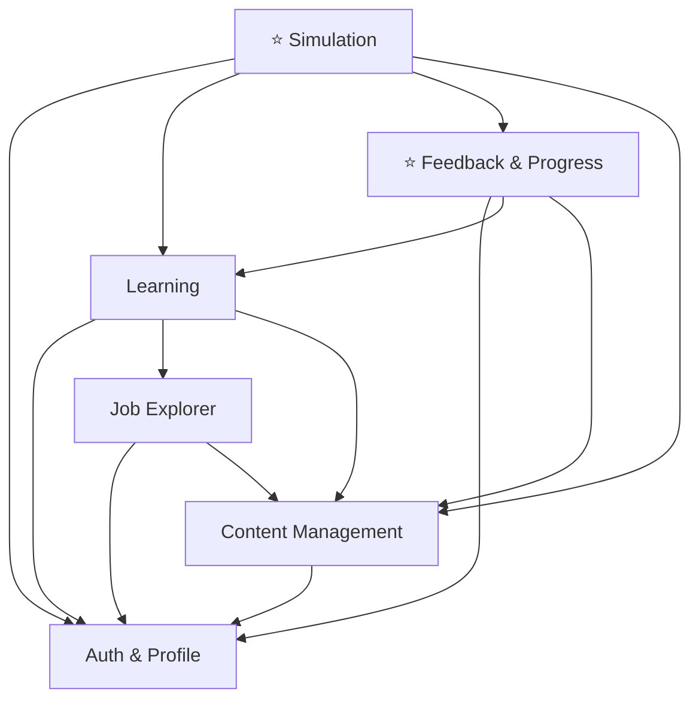

# D2. Module Breakdown

Inti CareerUp adalah **simulasi pekerjaan**: pengguna mencoba mengerjakan tugas yang meniru pekerjaan aslinya, lalu mendapat feedback. Modul lain mendukung alur itu, yaitu membantu pengguna memilih pekerjaan, mempersiapkan skill, dan mencatat hasilnya.

CareerUp dibagi menjadi **6 modul**, dengan dua modul inti (⭐) dan empat modul pendukung.

| Peran | Modul |
|-------|-------|
| ⭐ Inti | Simulation, Feedback & Progress |
| Pintu masuk | Job Explorer |
| Persiapan | Learning |
| Pendukung | Auth & Profile, Content Management |

**Alur pengguna:** Job Explorer (pilih pekerjaan) → Learning (siapkan skill) → ⭐ Simulation (kerjakan tugas) → ⭐ Feedback & Progress (lihat hasil)

---

## Daftar Modul

### 1. Auth & Profile
**Tanggung jawab:** Mengurus akun pengguna, hak akses berdasarkan peran (Job Seeker atau Admin CareerUp), dan data profil termasuk pekerjaan target.

**Fitur utama:**
- Register akun baru
- Login dan logout
- Membedakan peran Job Seeker dan Admin CareerUp
- Memeriksa hak akses sebelum fitur dibuka
- Menetapkan dan menyimpan pekerjaan target di profil pengguna

### 2. Job Explorer
**Tanggung jawab:** Menjadi pintu masuk pengguna: menampilkan pekerjaan beserta skill-nya sebagai bahan memilih pekerjaan target.

**Fitur utama:**
- Melihat dan mencari daftar pekerjaan
- Melihat gambaran pekerjaan dan skill yang dibutuhkan
- Menampilkan roadmap berdasarkan pekerjaan target: skill yang perlu disiapkan dan simulasi yang tersedia

### 3. Learning
**Tanggung jawab:** Menyiapkan pengguna sebelum simulasi lewat materi singkat yang hanya berisi skill yang akan dipakai di tugas simulasi.

**Fitur utama:**
- Materi singkat per skill, terhubung ke tugas simulasi yang relevan
- Latihan interaktif sebagai pemanasan
- Menandai materi selesai
- Menunjukkan skill mana yang sudah siap dan mana yang belum

### 4. ⭐ Simulation
**Tanggung jawab:** Menjalankan simulasi pekerjaan: menyajikan situasi kerja, tugas bertahap, memeriksa jawaban, dan menghitung skor.

**Fitur utama:**
- Memilih skenario kerja (misalnya "Hari pertama sebagai Admin Data Entry")
- Menampilkan tugas bertahap seperti yang dikerjakan di tempat kerja nyata
- Mendukung beberapa tipe tugas (pilihan ganda, isian, memperbaiki data)
- Validasi jawaban (misalnya tidak boleh ada yang kosong)
- Menghitung skor dan status kesiapan (`evaluate_simulation`)
- Mengulang simulasi saat status "Perlu Latihan Lagi"

### 5. ⭐ Feedback & Progress
**Tanggung jawab:** Memberi feedback atas hasil simulasi dan mencatat perkembangan pengguna.

**Fitur utama:**
- Feedback sesuai status (Siap / Hampir Siap / Perlu Latihan Lagi)
- Saran materi yang perlu diulang saat skor rendah
- Riwayat hasil simulasi
- Progres per pekerjaan

### 6. Content Management
**Tanggung jawab:** Memberi Admin CareerUp alat untuk mengelola semua konten platform, terutama skenario dan tugas simulasi.

**Fitur utama:**
- CRUD pekerjaan dan skill
- CRUD skenario dan task simulasi beserta kunci jawaban
- CRUD materi belajar
- Mengelola teks dan aturan feedback

---

## Ketergantungan Antar Modul

> Arti panah: `A --> B` berarti modul A **bergantung pada** modul B.

| Modul | Bergantung ke | Alasan |
|-------|---------------|--------|
| Auth & Profile | (tidak ada) | Modul dasar, tidak memerlukan modul lain. |
| Job Explorer | Auth & Profile, Content Management | Perlu tahu siapa penggunanya dan pekerjaan targetnya (disimpan di profil), dan data pekerjaan serta skill dikelola Content Management. |
| Learning | Auth & Profile, Job Explorer, Content Management | Materi ditampilkan sesuai skill dari pekerjaan target, dan materinya dikelola Content Management. |
| Simulation | Auth & Profile, Learning, Feedback & Progress, Content Management | Simulasi dibuka setelah persiapan belajar, membaca task dan kunci jawaban dari Content Management, lalu hasilnya dikirim ke Feedback & Progress. |
| Feedback & Progress | Auth & Profile, Learning, Content Management | Hasil dan progres disimpan per pengguna, saran materi diambil dari Learning, dan teks serta aturan feedback dikelola Content Management. |
| Content Management | Auth & Profile | Hanya Admin CareerUp yang boleh mengelola konten (cek peran). |

---

[← Kembali ke README](../README.md)
