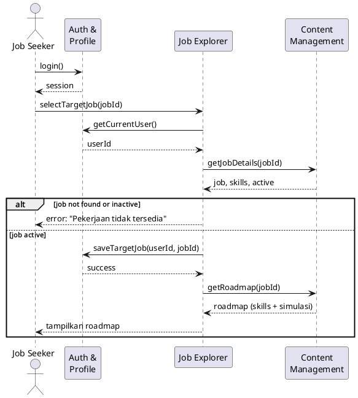
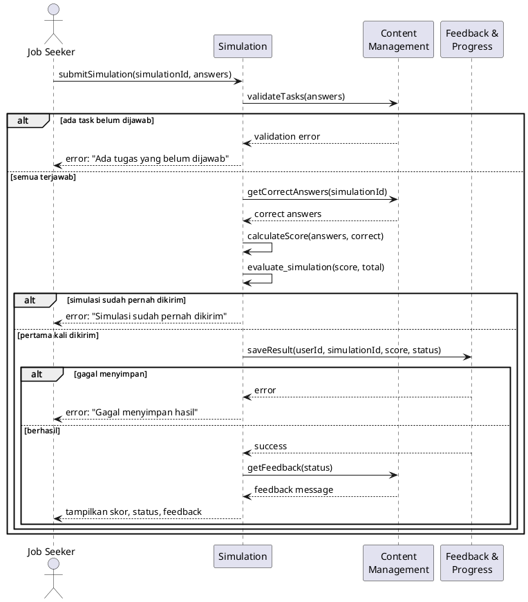
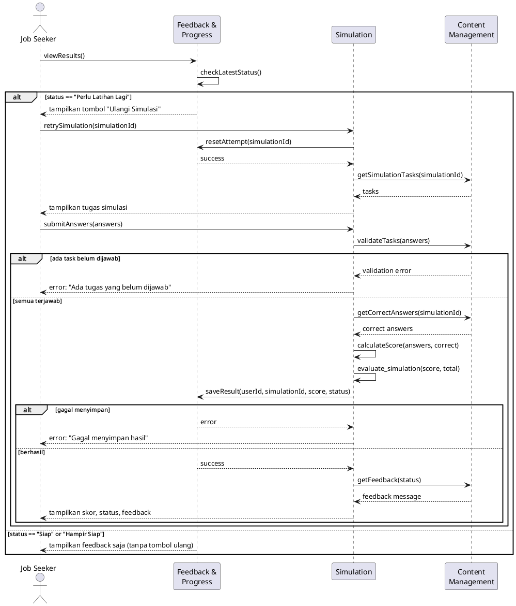

# D4. Sequence Diagrams (3 Key Scenarios)

Tiga skenario dipilih karena mewakili alur utama CareerUp: menetapkan tujuan, mengerjakan simulasi, dan memperbaiki hasil.

| # | Skenario | Pemegang | Modul utama |
|---|---|---|---|
| S1 | Menetapkan pekerjaan target dan melihat roadmap | Azkiya | Job Explorer, Auth & Profile |
| S2 | Mengerjakan simulasi dan menerima feedback | Sahfria | Simulation, Feedback & Progress |
| S3 | Mengulang simulasi | Azzam | Feedback & Progress, Simulation |

---

## S1. Menetapkan Pekerjaan Target dan Melihat Roadmap

**Kenapa penting:** Pekerjaan target menentukan skill, materi, dan simulasi yang ditampilkan ke pengguna. Tanpa langkah ini, pengguna tidak punya arah belajar di dalam aplikasi.

Source: [`diagrams/sequence1_target_job.puml`](../diagrams/sequence1_target_job.puml)

**Alur alternatif (`alt`):** jika pekerjaan tidak ditemukan atau sudah nonaktif, sistem menolak dan menampilkan pesan error. Jika ditemukan, pekerjaan target disimpan di profil dan roadmap ditampilkan.

---

## S2. Mengerjakan Simulasi dan Menerima Feedback

**Kenapa penting:** Ini inti CareerUp. Pengguna mengerjakan tugas simulasi, lalu mendapat skor, status kesiapan, dan feedback. Seluruh nilai aplikasi bergantung pada alur ini berjalan benar.

Source: [`diagrams/sequence2_simulasi.puml`](../diagrams/sequence2_simulasi.puml)

**Alur alternatif (`alt`):**
- Simulasi sudah pernah dikirim: ditolak supaya hasil tidak tersimpan ganda.
- Ada task belum dijawab: ditolak dengan pesan validasi.
- Semua terjawab: skor dan status dihitung, hasil disimpan, lalu feedback ditampilkan. Di dalamnya ada `alt` kedua untuk kasus gagal menyimpan hasil.

**Catatan:** `evaluate_simulation(correct, total)` adalah fungsi yang diuji di D7.

---

## S3. Mengulang Simulasi

**Kenapa penting:** Setelah status "Perlu Latihan Lagi", pengguna perlu bisa memperbaiki diri tanpa kehilangan riwayat percobaan sebelumnya, sehingga perkembangannya terlihat dari waktu ke waktu.

Source: [`diagrams/sequence3_retry.puml`](../diagrams/sequence3_retry.puml)

**Alur alternatif (`alt`):** tombol "Ulangi Simulasi" hanya muncul jika status "Perlu Latihan Lagi". Jika status "Hampir Siap" atau "Siap", hanya feedback yang ditampilkan.

---

## Konsistensi dengan Dokumen Lain
- Lifeline memakai nama modul dari [D2](D2.md) dan aktor dari [D1](D1.md).
- S3 sesuai dengan use case *Retry Simulation* di [D3](D3.md).
- Setiap anggota memegang satu diagram, dan itu dicatat di [`ACTIVITY_LOG.md`](../ACTIVITY_LOG.md).
