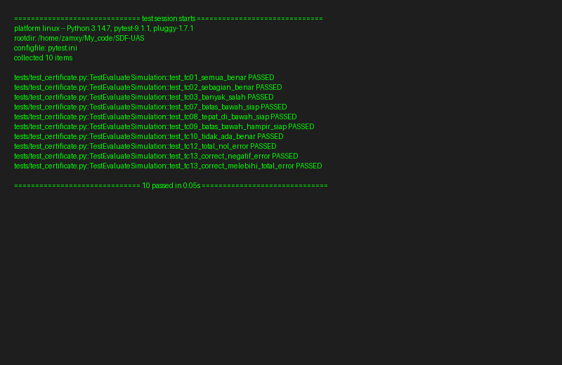

# D7. Fungsi `evaluate_simulation` + Unit Test

## Implementasi

Fungsi `evaluate_simulation(correct, total)` menghitung persentase jawaban benar dan mengembalikan status kesiapan:

| Rentang | Status |
|---|---|
| `persentase >= 80` | `Siap` |
| `persentase >= 60` dan `< 80` | `Hampir Siap` |
| `persentase < 60` | `Perlu Latihan Lagi` |

Validasi input:
- `total` harus lebih dari 0.
- `correct` harus antara 0 dan `total` (inklusif).

File: [`src/certificate.py`](../src/certificate.py)

---

## Hasil Test (Screenshot)

Semua test berhasil lulus.



File source test: [`tests/test_certificate.py`](../tests/test_certificate.py)

---

## Test Case yang Dijalankan

Berdasarkan D6, 10 unit test dijalankan:

| TC | Deskripsi | Input | Expected |
|---|---|---|---|
| TC-01 | Semua jawaban benar | 10/10 | Siap |
| TC-02 | Sebagian jawaban benar | 7/10 | Hampir Siap |
| TC-03 | Banyak jawaban salah | 3/10 | Perlu Latihan Lagi |
| TC-07 | Tepat di batas bawah Siap | 8/10 | Siap |
| TC-08 | Tepat di bawah batas Siap | 79/100 | Hampir Siap |
| TC-09 | Tepat di batas bawah Hampir Siap | 6/10 | Hampir Siap |
| TC-10 | Tidak ada jawaban benar | 0/10 | Perlu Latihan Lagi |
| TC-12 | Jumlah task nol | 0/0 | ValueError |
| TC-13 | Correct negatif | -1/10 | ValueError |
| TC-13 | Correct melebihi total | 11/10 | ValueError |

Cara menjalankan:
```bash
pip install -r requirements.txt
pytest
```

---

## Konsistensi
- Aturan status sama dengan yang didefinisikan di [D6](D6.md).
- Nama aktor dan modul sesuai [D1](D1.md) dan [D2](D2.md).
- Fungsi ini dipanggil di sequence diagram S2 (lihat [D4](D4.md)).
